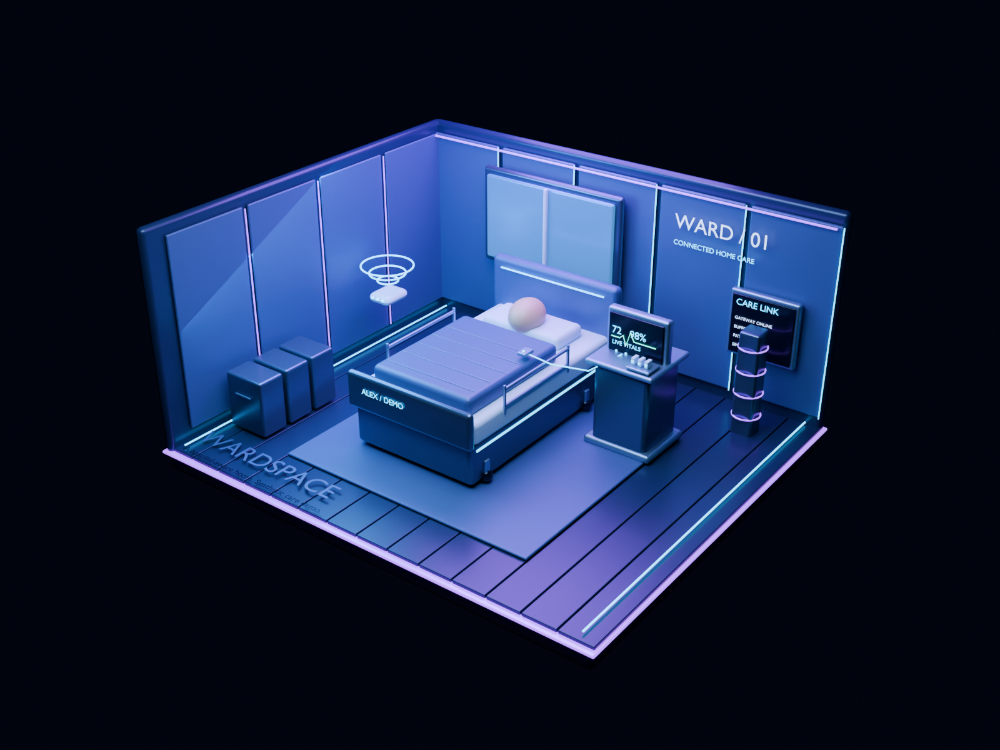

# WardSpace — a hospital-aware home

WardSpace combines an interactive 3D home-care environment with simulated patient monitoring, caregiver alerts, and a Round 2 AI handoff experiment. AutoScientist by Adaption trained a Qwen3.5-4B LoRA model on 1,800 synthetic alert histories and achieved a **91.54% platform best win rate**.

**Demo links**

1. **Vercel web demo** · [Open the complete WardSpace 3D experience](https://wardspace-healthcare.vercel.app/). Explore the original bedroom, patient telemetry, care console, and added Round 2 research section.
2. **Adaption Labs demo** · [Open WardSpace Handoff Intelligence](https://wardspace-handoff.adaptionlabs.app/). View the published training result, model details, and synthetic history interface. Live trained-model inference remains pending.

The [trained adapter is published on Hugging Face](https://huggingface.co/Saiyv43/WardSpace-Handoff-Qwen3.5-4B-LoRA). See [ROUND2.md](ROUND2.md) and [MODEL_CARD.md](MODEL_CARD.md) for setup, training evidence, and evaluation limitations.

WardSpace is an interactive 3D home-healthcare prototype built with Blender, Three.js, Vercel, and Neon. It combines simulated patient vitals, explainable risk scoring, caregiver alerts, and offline buffering in an immersive digital bedroom.

Sense → Understand → Predict → Alert → Respond

Uses synthetic data and demonstration rules; not clinically validated.
**Live website:** https://wardspace-healthcare.vercel.app

A persistent cinematic 3D experience with a spatial patient HUD meets a working home-care simulation: **Sense → Understand → Predict → Alert → Respond**.



## Run in VS Code

Open this folder. Python 3.10+ runs the local application without dependencies:

```sh
python server.py
```

Visit http://127.0.0.1:8000. The ZIP includes the bundled 3D viewer; to rebuild it, install Node.js 20+ and run `npm ci` then `npm run build`. The local API stores events in SQLite. No API keys, hardware or external AI service are needed for local mode.

## What works

- Detailed sci-fi Blender bedroom with titanium materials, luminous panels, animated breathing blanket, gateway pulses and a cinematic camera clip.
- Four connected Three.js scenes: smart bedroom, procedural intelligence core, moving alert network and caregiver display. Scroll camera choreography, zoom explanations, physical camera presets, animation pause, reduced-motion handling and an image fallback.
- Five simulated vital streams, trend sparklines, stable/fever/deterioration/recovery scenarios.
- Transparent Low/Medium/High rule scoring with reasons and English caregiver note keywords.
- Alert acknowledgment, explicit simulated caregiver responses, attendance self-report and downloadable history.
- Persistent browser outbox, idempotent event ingestion, reconnect retry, simulated power loss, stale-data indication, service-worker cache after initial visit.
- Vercel Node API and Neon Postgres schema; standalone Python/SQLite local alternative.

## Three-minute demo

**Watch the recorded walkthrough:** https://wardspace-healthcare.vercel.app/demo.html

**Direct MP4 for submissions:** https://wardspace-healthcare.vercel.app/demo.mp4


See [DEMO.md](DEMO.md) for the timed walkthrough. Select Deterioration and wait ~30 seconds to cross thresholds. Acknowledge the alert, then record a simulated response. Demonstrate offline buffering and reconnect. Do not present synthetic results as clinical validation.

## Vercel + Neon

1. Apply `migrations/001_events.sql` to a dedicated Neon database.
2. Import this GitHub repository into Vercel. Framework: Other, build: `npm run build`, output: `public`.
3. Set **server-only** `DATABASE_URL` in Vercel (pooled Neon connection string with SSL). Never put it in public files or commit it.
4. Deploy. `POST /api/events` persists events and recalculates risk on the server. `GET /api/events?session=<browser-session-uuid>` retrieves that demo session's recent events.

The database has been provisioned separately; credentials are deliberately excluded from source and ZIP.

## Blender

Open `WardSpace.blend` in Blender 5.2. Press Space in the timeline to play frames 1–180. `build_room.py` recreates the scene, exports `public/room.glb` and renders `public/room.png`:

```sh
blender --background --python build_room.py
```

## Checks

```sh
python -m unittest discover -s tests
node --check public/app.js
node --check api/events.js
```

## Safety and scope

**Experimental software, synthetic patients only.** Thresholds are illustrative and unvalidated. No diagnosis, treatment recommendations, calibrated probability, or validated 24–48 hour forecast is provided. Trend detection across five accelerated samples is an exploratory pattern only. Keywords cannot reliably interpret clinical language. Caregiver acknowledgment does not prove patient safety.

Escalation and caregiver contact are in-app simulations. There are no real SMS/phone notifications, hardware integrations, verified attendance, battery backup or background monitoring after the browser closes. An in-app demonstration satisfies the alert/acknowledgment wording supplied, but only the organizer can confirm channel requirements.

Public demo sessions use unguessable browser IDs, not authenticated clinical accounts. This is not an access-control boundary for real records. No real patient data should be entered. Production needs authenticated roles, audit integrity, retention limits, rate limiting, validated clinical thresholds, notification delivery guarantees and prospective evaluation. Browser storage is not encrypted clinical storage.

## Submission checklist

- Source repository and technical documentation: included.
- Blender source and reproducible exporter: included.
- Working prototype: included; test the final hosted deployment before submission.
- Three-minute video: recorded, captioned walkthrough included as `public/demo.mp4`. The presentation records the live rendered scene and telemetry while operating the app controls.
- Supplied rules require 2–3 members and list an October 24, 2026 deadline. Confirm any extension with the organizer.

## Attribution

Original room geometry created procedurally in Blender. Website uses Three.js (MIT), esbuild (MIT), bundled Google model-viewer (Apache-2.0, retained legacy viewer), node-postgres (MIT), Vercel Functions utilities (MIT), and Google Fonts DM Sans/Manrope (SIL Open Font License). System font fallback works offline. AI assistance was used for implementation; the submitting team must understand and explain the code.

## October 2026 update

- Searchable activity log for readings, notes, check-ins, acknowledgments and responses; newest 200 browser events, latest 30 matches displayed.
- Filtered CSV export with escaped cells and spreadsheet formula protection; existing JSON download retains the complete browser snapshot.
- Recovery from malformed saved JSON and explicit network-offline indication.
- Local history API now requires a session and filters results by session, matching hosted behavior. Session IDs remain demo isolation, not authentication.
- Updated offline asset cache includes the activity log and removes previous WardSpace caches on activation.

Run regression checks with `npm test` and `node --test tests/activity.test.cjs`. The ZIP includes generated viewer assets; run `python server.py` to start directly in VS Code.
